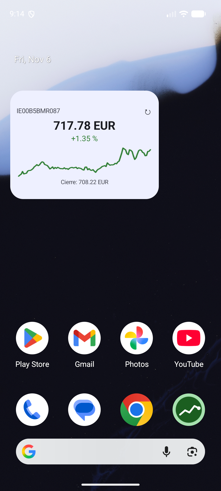

# ETF Widget

Widget de Android para la pantalla de inicio que muestra la cotización de un ETF en
**tiempo real**, con la gráfica del día y refresco automático. Sin registro, sin backend
y sin API key: todo en local.




## Qué hace

- Muestra ticker, **precio en tiempo real**, variación del día (en verde/rojo) y la
  **sparkline** (mini-gráfica) de la jornada.
- Se adapta al tamaño: pequeño (precio), mediano (+ gráfica), grande (+ cierre anterior).
- **Refresco automático cada 15 min** (WorkManager) y botón **↻** para forzarlo al momento.
- Avisos de **"Cerrado"** fuera de horario y **"Sin red"** si falla la conexión
  (manteniendo el último precio).
- Tema **claro/oscuro** automático. Al tocar el widget se abre la app de configuración.

## Stack

| Pieza | Tecnología |
|---|---|
| Lenguaje | Kotlin |
| UI de la app | Jetpack Compose + Material 3 |
| Widget | **Glance** (`androidx.glance:glance-appwidget`) |
| Refresco periódico | WorkManager |
| Persistencia | DataStore Preferences |
| Red | `HttpURLConnection` + `org.json` (sin librerías extra) |
| Datos | **Tradegate** (tiempo real, por ISIN) + Yahoo Finance (serie para la gráfica) |
| CI | GitHub Actions (compila y pasa tests en cada PR) |

## Arquitectura

```
UI (MainActivity)  ─┐                                        ┌─ TradegateQuoteRepository (precio real)
Widget (Glance)    ─┼─► QuoteUpdater ─► QuoteRepository ──────┤
Worker (15 min)    ─┘        │          (interfaz)            └─ YahooQuoteRepository (serie del día)
                             └─► QuoteStore (DataStore) ◄── el widget pinta desde aquí
```

## Decisiones técnicas

Lo interesante del proyecto no es que "muestre un número", sino el porqué de cada decisión:

- **El widget nunca hace peticiones de red al pintarse.** Android repinta los widgets cuando
  quiere; hacer red ahí sería lento y poco fiable. En su lugar, el widget **lee de DataStore**
  (instantáneo) y un *worker* mantiene ese dato fresco cada 15 min. El dato y el dibujo van por
  separado.

- **Tradegate para el precio, Yahoo para la gráfica.** Tradegate da el precio en **tiempo real**
  y es la bolsa que ve el usuario en su banco (horario 08:00–22:00, más amplio que Xetra porque
  sigue a EE.UU. por la tarde). Pero su endpoint no devuelve la serie del día, así que la
  **sparkline** se saca de Yahoo. Curiosamente hay que pedírsela a **Xetra** (`.DE`), porque
  Stuttgart (`.SG`) no publica barras intradía al ser menos líquida.

- **El proveedor de datos va detrás de una interfaz** (`QuoteRepository`). Así se puede cambiar
  la fuente sin tocar el resto de la app: Tradegate es el principal y Yahoo queda como
  alternativa/complemento.

- **Parseo a prueba de fallos.** El endpoint (no oficial) de Tradegate devuelve los números de
  forma inconsistente: a veces `740.66` (número) y a veces `"740,60"` (texto con coma alemana).
  El parseo normaliza ambos casos, y está **cubierto por tests unitarios**.

- **La sparkline se dibuja en un `Bitmap`** con `Canvas`, porque Glance no tiene un `Canvas`
  propio; luego se muestra con un `Image`.

## Limitación asumida

Los datos son tiempo real, pero el **refresco automático** del widget es cada 15 min (el mínimo
que Android permite para tareas periódicas, por batería). El botón ↻ fuerza una lectura al
momento. Para un ETF de largo plazo, de sobra.

> La fuente de Tradegate es un endpoint **no oficial**; por eso el proveedor está detrás de una
> interfaz, para poder cambiarlo si deja de funcionar.

## Compilar / instalar

```bash
./gradlew assembleDebug
```

El APK de debug queda en `app/build/outputs/apk/debug/`. Para un APK firmado de release:
*Build → Generate Signed App Bundle / APK* en Android Studio.

> En móviles con gestión agresiva de batería (Xiaomi, Huawei, Samsung, ZTE…) conviene quitarle
> la optimización de batería a la app para que el refresco automático se ejecute.

## Próximos pasos

- Elegir el ETF por ISIN resolviéndolo a símbolo automáticamente (ahora el símbolo de la gráfica
  está fijado).
- Varios ETFs, cada widget con el suyo.
- Release automático del APK firmado con GitHub Actions al crear un tag.
